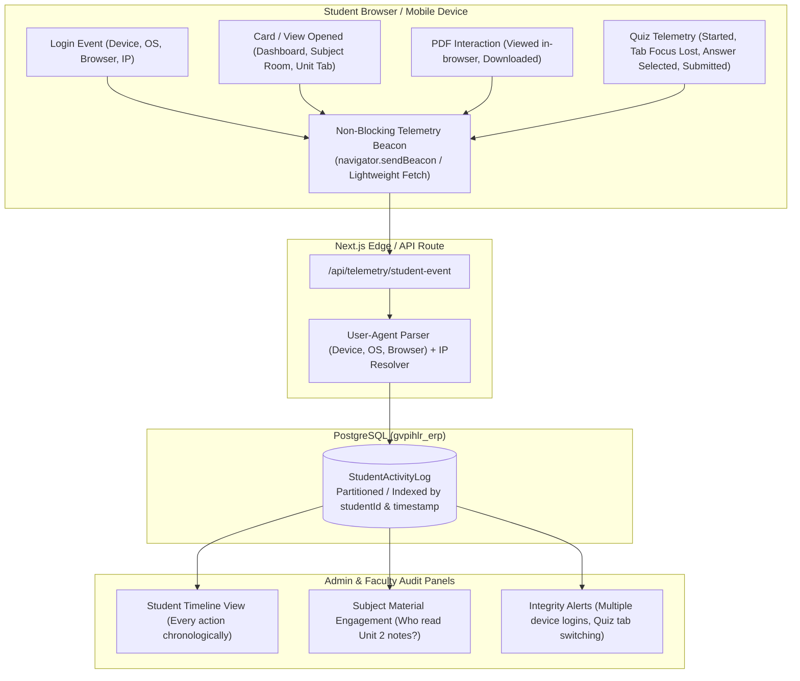
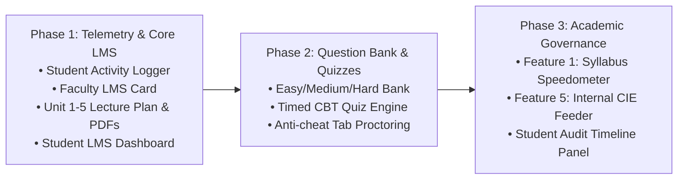

# GVPIHLR LMS & Student Activity Telemetry System - Comprehensive Implementation Plan

## 1. Executive Summary & Capabilities Confirmation

**Yes, we can implement 100% of these capabilities seamlessly.** 
Because GVPIHLR already has a unified database housing all 1,187 active students, 89 faculty, semester rosters, and attendance records, building this natively eliminates third-party licensing costs, synchronization delays, and data fragmentation.

This document details the blueprint for:
1. **Faculty LMS Studio Card**: Unit-wise Lecture Plan, Syllabus Topics tracker, Material (PDF) repository, Question Bank with Difficulty levels (Easy/Medium/Hard), and Section Quizzes.
2. **Dedicated Student LMS Dashboard**: Subject rooms, roadmap, in-browser PDF reader, practice mode, and timed section quizzes.
3. **Comprehensive Student Activity & Telemetry Engine (Audit Logging)**: Millisecond-level tracking of every login, device fingerprint, card view, tab switch, PDF preview, PDF download, and quiz activity.
4. **Syllabus Coverage Speedometer (HOD/Dean View)** (Feature 1).
5. **Continuous Internal Evaluation (CIE) & Internal Marks Feeder** (Feature 5).

---

## 2. High-Precision Student Activity Telemetry Architecture

To capture *"every tiny process the student is doing"* without degrading website speed or database performance, we employ an **Asynchronous Telemetry Event Pipeline**.

### Telemetry Pipeline Diagram



### Granular Events Captured
| Event Category | Action Logged | Captured Metadata |
| :--- | :--- | :--- |
| **Authentication** | `AUTH_LOGIN` | Device type (Mobile/Desktop/Tablet), OS (iOS, Android, Windows, Mac), Browser name & version, IP address, Timestamp |
| **Session** | `AUTH_LOGOUT`, `SESSION_TIMEOUT` | Active session duration, reason for termination |
| **Navigation** | `VIEW_DASHBOARD`, `VIEW_LMS_HOME` | Page URL, referrer, time spent on dashboard |
| **Subject Room** | `OPEN_SUBJECT_ROOM` | Subject code (e.g. `26MA101`), Faculty name, Section ID |
| **Lecture Plan** | `VIEW_LECTURE_PLAN` | Unit selected, topic clicked |
| **Material Access** | `VIEW_MATERIAL_INLINE` | Material ID, Unit number, Document title, Dwell time |
| **Material Download** | `DOWNLOAD_MATERIAL_FILE` | Material ID, File name, Network speed/size |
| **Question Bank** | `BROWSE_QUESTION_BANK` | Unit filter, Difficulty filter (Easy/Medium/Hard) |
| **Online Quiz** | `QUIZ_START`, `QUIZ_SUBMIT` | Quiz ID, Duration elapsed, Score obtained |
| **Quiz Proctoring** | `QUIZ_WINDOW_BLUR`, `TAB_SWITCH` | Number of times student navigated away from exam tab |

---

## 3. Database Schema Blueprint (Prisma)

This schema directly extends the existing `prisma/schema.prisma` without disturbing current tables or data.

```prisma
// =========================================================================
// 1. GRANULAR STUDENT ACTIVITY TELEMETRY
// =========================================================================

enum ActivityCategory {
  AUTH
  NAVIGATION
  MATERIAL_VIEW
  MATERIAL_DOWNLOAD
  QUIZ_INTERACTION
  PROFILE_UPDATE
}

model StudentActivityLog {
  id              String           @id @default(cuid())
  studentId       String
  student         Student          @relation(fields: [studentId], references: [id], onDelete: Cascade)
  category        ActivityCategory
  action          String           // e.g. "AUTH_LOGIN", "PDF_DOWNLOAD", "TAB_SWITCH"
  targetResource  String?          // e.g. "26MA101", "material_cuid123", "quiz_cuid456"
  description     String           // Human readable e.g. "Downloaded Unit 2 Formula Sheet PDF"
  ipAddress       String?
  deviceType      String?          // "Mobile", "Desktop", "Tablet"
  deviceModel     String?          // "iPhone", "Samsung Galaxy S23", "Windows PC"
  os              String?          // "Windows 11", "Android 14", "iOS 17"
  browser         String?          // "Chrome 128", "Safari 17", "Edge 128"
  userAgent       String?          @db.Text
  metadata        Json?            // Stores dwell time, page number, quiz switch count
  createdAt       DateTime         @default(now())

  @@index([studentId, createdAt])
  @@index([category, createdAt])
  @@index([targetResource])
}

// =========================================================================
// 2. LECTURE PLAN & UNIT SYLLABUS TOPICS
// =========================================================================

enum DeliveryStatus {
  PLANNED
  IN_PROGRESS
  COMPLETED
  RESCHEDULED
}

model LecturePlanTopic {
  id              String                   @id @default(cuid())
  assignmentId    String
  assignment      FacultySubjectAssignment @relation(fields: [assignmentId], references: [id], onDelete: Cascade)
  unitNumber      Int                      // 1, 2, 3, 4, 5
  topicSequence   Int                      // Order within unit
  topicTitle      String
  subTopics       String?                  @db.Text
  plannedDate     DateTime
  actualDate      DateTime?
  status          DeliveryStatus           @default(PLANNED)
  deliveryMode    String?                  // "Chalk & Talk", "Presentation", "Lab Demo"
  remarks         String?
  createdAt       DateTime                 @default(now())

  @@index([assignmentId, unitNumber])
}

// =========================================================================
// 3. UNIT-WISE STUDY MATERIALS (PDF / PPT / VIDEO-READY)
// =========================================================================

enum MaterialType {
  LECTURE_NOTES_PDF
  SLIDES_PPT
  SYLLABUS_COPY
  FORMULA_SHEET
  REFERENCE_LINK
  VIDEO_LECTURE        // Architectural placeholder for future activation
}

model CourseMaterial {
  id              String                   @id @default(cuid())
  assignmentId    String
  assignment      FacultySubjectAssignment @relation(fields: [assignmentId], references: [id], onDelete: Cascade)
  unitNumber      Int                      // 1 to 5
  title           String
  description     String?
  type            MaterialType             @default(LECTURE_NOTES_PDF)
  fileUrl         String                   // Path or Cloudflare R2 / local uploads
  fileName        String
  fileSize        Int?                     // Bytes
  viewCount       Int                      @default(0)
  downloadCount   Int                      @default(0)
  createdAt       DateTime                 @default(now())

  @@index([assignmentId, unitNumber])
}

// =========================================================================
// 4. QUESTION BANK & BLOOM'S TAXONOMY
// =========================================================================

enum QuestionDifficulty {
  EASY
  MEDIUM
  HARD
}

enum QuestionType {
  MCQ
  SHORT_ANSWER
  DESCRIPTIVE
}

model QuestionBankItem {
  id              String                   @id @default(cuid())
  subjectId       String
  assignmentId    String?                  // Optional: Can be pooled college-wide or section-bound
  unitNumber      Int                      // 1 to 5
  difficulty      QuestionDifficulty       @default(MEDIUM)
  type            QuestionType             @default(MCQ)
  questionText    String                   @db.Text
  options         Json?                    // Array of choices for MCQ: ["Opt A", "Opt B", "Opt C", "Opt D"]
  correctOption   Int?                     // Index 0, 1, 2, 3
  explanation     String?                  @db.Text
  bloomsLevel     String?                  // "Remember", "Understand", "Apply", "Analyze"
  marks           Float                    @default(1.0)
  createdAt       DateTime                 @default(now())

  @@index([subjectId, unitNumber, difficulty])
}

// =========================================================================
// 5. SECTION-BOUND ONLINE QUIZZES & AUTO-GRADING
// =========================================================================

model CourseQuiz {
  id              String                   @id @default(cuid())
  assignmentId    String
  assignment      FacultySubjectAssignment @relation(fields: [assignmentId], references: [id], onDelete: Cascade)
  title           String
  unitNumber      Int?
  durationMinutes Int                      @default(20)
  totalMarks      Float                    @default(20.0)
  startTime       DateTime
  endTime         DateTime
  isPublished     Boolean                  @default(false)
  allowReview     Boolean                  @default(true)
  createdAt       DateTime                 @default(now())

  questions       QuizQuestionMapping[]
  attempts        QuizStudentAttempt[]

  @@index([assignmentId])
}

model QuizQuestionMapping {
  id              String                   @id @default(cuid())
  quizId          String
  quiz            CourseQuiz               @relation(fields: [quizId], references: [id], onDelete: Cascade)
  questionBankId  String
  marks           Float                    @default(1.0)
  order           Int                      @default(1)
}

model QuizStudentAttempt {
  id              String                   @id @default(cuid())
  quizId          String
  quiz            CourseQuiz               @relation(fields: [quizId], references: [id], onDelete: Cascade)
  studentId       String
  student         Student                  @relation(fields: [studentId], references: [id], onDelete: Cascade)
  score           Float
  submittedAnswers Json                    // Stores selected options per question
  tabSwitchCount  Int                      @default(0) // Anti-cheat proctoring
  startedAt       DateTime                 @default(now())
  completedAt     DateTime?

  @@unique([quizId, studentId])
  @@index([studentId])
}
```

---

## 4. Feature Details & Workflows

### Module 1: Faculty LMS Studio Card
- **Location**: Prominently featured on the main Faculty Dashboard alongside Attendance and Marks.
- **Section Selector**: Dropdown showing all sections assigned to the faculty (e.g. *B.Tech CSE-A: 26MA101*).
- **Tab 1: Lecture Plan**:
  - Add/Edit topics under Units 1 to 5.
  - One-click status marker: `Planned` ➔ `Completed`.
- **Tab 2: Unit Materials**:
  - Upload PDF/document attachments organized by unit.
  - Live counters showing how many students have viewed or downloaded the file.
- **Tab 3: Question Bank**:
  - Filter questions by Unit (1 to 5) and Difficulty (Easy, Medium, Hard).
  - Bulk question creator or single interactive entry.
- **Tab 4: Section Quizzes**:
  - Checkbox-select 10–20 questions from the Question Bank.
  - Set test window (e.g., Friday 3:00 PM – 4:00 PM) and duration (20 mins).
  - View live student submission roster with anti-cheat tab-switch alerts.

---

### Module 2: Dedicated Student LMS Portal (`/student/lms`)
- **Clean Academic Room**: Accessible via the sidebar and top navigation.
- **Course Shelf**: Displays enrolled subjects for the active semester with teacher photo and department badge.
- **Subject Dashboard**:
  - **Syllabus & Lecture Tracker**: Students see exactly which topics have been taught and upcoming lessons.
  - **Unit Material Accordion (Units 1–5)**:
    - Built-in PDF preview modal (renders cleanly on smartphones without requiring Adobe Reader or third-party apps).
    - Single-click Download button.
    - Automatic background beacon logging the view/download action.
  - **Self-Study Question Bank Practice**:
    - Students can review practice questions by unit, choosing to test themselves against *Easy*, *Medium*, or *Hard* questions.
  - **Live Quiz Room**:
    - Active quizzes displayed with a countdown clock.
    - Distraction-free exam mode with question navigation panel.
    - Warning banner if the student switches tabs or minimizes the window.

---

### Module 3: Feature 1 – Syllabus Coverage Speedometer (HOD & Dean View)
- Real-time aggregation of `LecturePlanTopic` status per department.
- **Metrics Calculated**:
  - Department-wide syllabus completion percentage.
  - Subject-by-subject velocity (e.g. *CSE 1st Year: Math 78% (On Track), Physics 52% (Delayed)*).
  - Flags subjects that have not covered required units prior to Mid-1 and Mid-2 dates.
- Exportable PDF report for Academic Council and Principal review meetings.

---

### Module 4: Feature 5 – Continuous Internal Evaluation (CIE) Feeder
- Direct mathematical synthesis of internal performance:
  $$\text{Internal Score} = f(\text{Mid-1 Exam}, \text{Mid-2 Exam}, \text{LMS Quizzes}, \text{Attendance \%})$$
- Automatically imports quiz scores directly into the institution's Mid-marks calculation ledger.
- Eliminates manual faculty data entry and prevents clerical transcription errors.

---

### Module 5: Administrative & Faculty Student Audit Panel
- **Student Profile Audit Tab**: Accessible to Admins and Mentors under `/admin/students/[id]`.
- Displays the complete chronological feed of student activity:
  - *“Logged in from iPhone (Safari) at 08:42 AM from IP 103.xxx.xxx”*
  - *“Opened LMS Portal at 08:43 AM”*
  - *“Viewed Unit-2 Calculus Lecture Notes for 14 minutes”*
  - *“Downloaded Unit-2 Question Bank (Hard Difficulty) at 08:58 AM”*
  - *“Completed Unit-1 Quiz: Score 18/20 (Tab switches: 0)”*
- **Subject Engagement Heatmap**: Faculty can inspect which students in their section have not opened the required study materials before exams.

---

## 5. Phased Implementation Roadmap



### Phase 1: Foundation & Telemetry
1. Create `StudentActivityLog`, `LecturePlanTopic`, and `CourseMaterial` models in Prisma schema.
2. Build `/api/telemetry/student-event` endpoint with automatic device/OS/browser user-agent parser.
3. Build **Faculty LMS Studio Card** (`/faculty/lms`) with Lecture Plan editor and Unit 1–5 PDF uploader.
4. Build **Student LMS Dashboard** (`/student/lms`) with subject rooms, unit tabs, and in-browser PDF reader with view/download event tracking.

### Phase 2: Question Bank & Quizzes
1. Create `QuestionBankItem`, `CourseQuiz`, and `QuizStudentAttempt` models.
2. Build Faculty Question Bank manager with Difficulty levels (Easy/Medium/Hard) and Bloom's taxonomy.
3. Build Section Quiz authoring tool and timed student test-taking portal with tab-switch logging.

### Phase 3: Analytics & Institutional Synthesis
1. Build **Feature 1**: HOD Syllabus Coverage Speedometer.
2. Build **Feature 5**: Continuous Internal Evaluation (CIE) automatic marks feeder.
3. Build Student Activity Audit Timeline for Admins and Faculty Mentors.

---

## 6. Safety & Zero Data Loss Guarantee
- All changes are strictly additive.
- Existing tables (`Student`, `Faculty`, `Subject`, `AttendanceSession`, `AttendanceMark`) remain 100% untouched.
- All 1,187 students, 89 faculty, and 113,952+ attendance marks remain fully protected.
