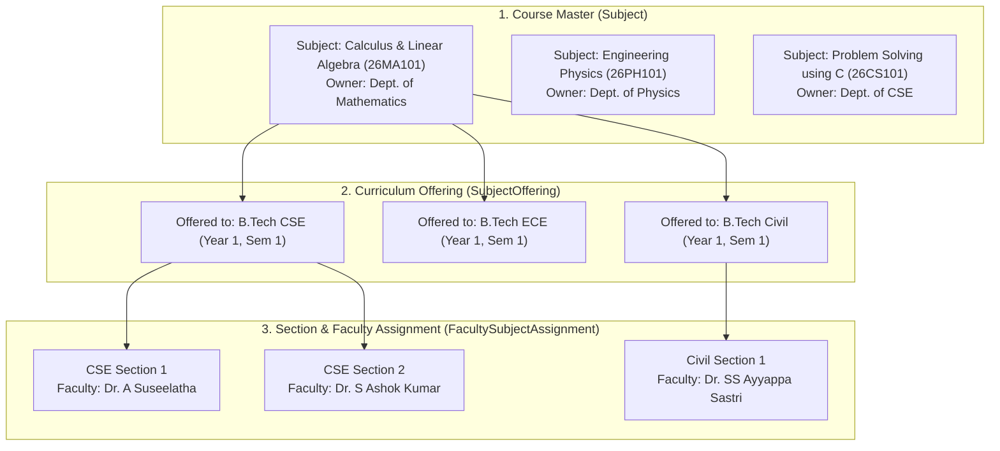

# GVPIHLR Learning Management System (LMS) - Architectural Blueprint & Expansion Plan

## 1. Executive Summary

This document outlines the strategic, architectural, and technical blueprint for expanding the **GVPIHLR Campus Management System (CMS/ERP)** into a unified **Learning Management System (LMS)**.

Unlike standalone LMS platforms (e.g., Moodle, Canvas, Blackboard, or Google Classroom) that require continuous synchronization and third-party integrations, GVPIHLR LMS is natively unified with the institution's existing academic database:
- **Zero Synchronization Overhead**: All **1,187 active students**, **89 faculty**, programs, sections, and subjects are already live and mapped.
- **Single Sign-On (SSO)**: Students and faculty use the exact same institutional credentials and roll numbers.
- **Direct ERP & Attendance Synthesis**: Attendance records (113,952+ verified sessions), internal marks, and academic standing interact seamlessly with continuous learning evaluations.

---

## 2. Academic Hierarchy & Course Mapping Engine

The system organizes academic delivery through a clean, relational 3-tier hierarchy:



### How 1st-Year Common Subjects Are Handled Without Duplication

In 1st-year engineering, foundational subjects are shared across branches (CSE, ECE, Civil, Mechanical, Data Science, Cyber Security, etc.):

1. **Single Source of Truth (`Subject`)**:
   - `26MA101` (*Calculus and Linear Algebra*) is defined **once** under the **Department of Mathematics**.
   - Contains unit-by-unit syllabus, textbooks, credits (e.g., 3.0), and course outcomes (COs).
2. **Branch Offerings (`SubjectOffering`)**:
   - The same course code is mapped to multiple degree programs for Year 1, Semester 1.
3. **Section-Level Faculty Allocation (`FacultySubjectAssignment`)**:
   - Each section (e.g., CSE Sec 1, Civil Sec 1) is assigned its specific faculty member or team of faculty (primary and co-faculty).
   - In the live database, `26MA101` is actively delivered across 35 distinct section-faculty pairings.

### The LMS Advantage of this Structure
- **Centralized Master Courseware**: The Mathematics Department uploads official syllabus notes, formula books, and lecture PPTs once; **all 1st-year students college-wide** get verified access.
- **Section-Isolated Classrooms**: Homework, assignments, deadlines, viva marks, and doubts remain strictly private to each section and its assigned faculty.

---

## 3. Core LMS Functional Modules

### Module 1: E-Courseware & Study Materials Repository
- **Unit-Wise Syllabus Organizer**: Structured navigation for Units 1 through 5.
- **Digital Assets**: Faculty upload lecture slides (PPT/PDF), typed notes, question banks, previous semester exam papers, and embedded video lectures (YouTube/NPTEL).
- **In-Browser Document Reader**: Students preview PDFs directly on web and mobile devices with fast load times.

### Module 2: Homework & Digital Assignments
- **Faculty Publishing**: Title, detailed prompt, reference attachments, deadline timestamp, submission format, and maximum marks.
- **Student Submissions**: Document uploads (PDF, DOCX, ZIP, or code snippets) with on-time vs. late-submission tracking.
- **Evaluation & Feedback**: Faculty view submissions in-browser, annotate or assign marks, and provide constructive private feedback.

### Module 3: Online Quizzes & Objective Tests (CBT)
- **Question Bank**: Multiple-choice questions categorized by subject, unit, and difficulty level.
- **Configurable Exam Settings**: Time limit (e.g., 20 mins), randomized question orders, randomized option shuffling, and automatic submission on countdown expiry.
- **Instant Auto-Grading**: Immediate result generation with question-by-question explanations.

### Module 4: Continuous Evaluation & Internal Marks Gradebook
- Automated calculation of internal marks synthesizing:
  - **Mid-1 Examination Marks**
  - **Mid-2 Examination Marks**
  - **Continuous Assignment Submissions**
  - **Attendance Weightage** (automatically calculated from the ERP's 113,952+ verified records)
  - **Lab Viva & Record Marks**
- One-click export to official university marks dossier format.

### Module 5: Course Announcements & Interactive Doubts Forum
- Faculty broadcast section-specific circulars, exam dates, or project guidelines.
- Discussion thread per topic where students can ask academic doubts and receive answers from faculty or peers.

### Module 6: Course Delivery & Syllabus Completion Tracker
- Faculty log completed topics and dates against the planned syllabus.
- Visual progress bar showing syllabus completion (e.g., *Unit 3: 85% completed*).
- HOD and Dean monitoring dashboard tracking syllabus coverage pace across departments.

---

## 4. Proposed Database Schema Extension (Zero-Impact Addition)

The LMS module directly extends existing tables (`FacultySubjectAssignment`, `Student`, `User`) without disrupting attendance or enrollment tables.

```prisma
// =========================================================================
// LMS MODULE EXTENSIONS
// =========================================================================

enum MaterialType {
  LECTURE_NOTES
  PRESENTATION
  SYLLABUS
  QUESTION_BANK
  REFERENCE_LINK
  VIDEO_LECTURE
}

enum SubmissionStatus {
  SUBMITTED
  LATE
  GRADED
  RESUBMIT_REQUESTED
}

// 1. Digital Study Materials
model CourseMaterial {
  id                  String                    @id @default(cuid())
  assignmentId        String?                   // If specific to section
  assignment          FacultySubjectAssignment? @relation(fields: [assignmentId], references: [id], onDelete: Cascade)
  subjectId           String?                   // If shared college-wide for common subject
  unitNumber          Int                       // 1, 2, 3, 4, 5
  title               String
  description         String?
  type                MaterialType              @default(LECTURE_NOTES)
  fileUrl             String
  fileSize            Int?
  uploadedById        String
  createdAt           DateTime                  @default(now())

  @@index([assignmentId])
  @@index([subjectId])
}

// 2. Course Assignments & Homework
model CourseAssignment {
  id                  String                    @id @default(cuid())
  assignmentId        String                    // Bound to FacultySubjectAssignment
  assignment          FacultySubjectAssignment  @relation(fields: [assignmentId], references: [id], onDelete: Cascade)
  title               String
  description         String                    @db.Text
  attachmentUrl       String?
  maxMarks            Float                     @default(10.0)
  dueDate             DateTime
  allowLateSubmission Boolean                   @default(false)
  createdAt           DateTime                  @default(now())

  submissions         AssignmentSubmission[]

  @@index([assignmentId])
}

// 3. Student Homework Submissions
model AssignmentSubmission {
  id                  String            @id @default(cuid())
  courseAssignmentId  String
  courseAssignment    CourseAssignment  @relation(fields: [courseAssignmentId], references: [id], onDelete: Cascade)
  studentId           String
  student             Student           @relation(fields: [studentId], references: [id], onDelete: Cascade)
  fileUrl             String
  submissionText      String?           @db.Text
  status              SubmissionStatus  @default(SUBMITTED)
  submittedAt         DateTime          @default(now())
  marksAwarded        Float?
  feedback            String?
  gradedAt            DateTime?

  @@unique([courseAssignmentId, studentId])
  @@index([studentId])
}

// 4. Online Quizzes & Objective Assessments
model CourseQuiz {
  id                  String                    @id @default(cuid())
  assignmentId        String
  assignment          FacultySubjectAssignment  @relation(fields: [assignmentId], references: [id], onDelete: Cascade)
  title               String
  durationMinutes     Int                       @default(20)
  totalMarks          Float                     @default(20.0)
  startTime           DateTime
  endTime             DateTime
  isPublished         Boolean                   @default(false)

  questions           QuizQuestion[]
  attempts            QuizAttempt[]

  @@index([assignmentId])
}

model QuizQuestion {
  id          String      @id @default(cuid())
  quizId      String
  quiz        CourseQuiz  @relation(fields: [quizId], references: [id], onDelete: Cascade)
  question    String      @db.Text
  options     Json        // ["Option A", "Option B", "Option C", "Option D"]
  correctIdx  Int         // 0, 1, 2, 3
  marks       Float       @default(1.0)
}

model QuizAttempt {
  id          String      @id @default(cuid())
  quizId      String
  quiz        CourseQuiz  @relation(fields: [quizId], references: [id], onDelete: Cascade)
  studentId   String
  student     Student     @relation(fields: [studentId], references: [id], onDelete: Cascade)
  score       Float
  answers     Json
  submittedAt DateTime    @default(now())

  @@unique([quizId, studentId])
}
```

---

## 5. Portal-by-Portal User Experience

### A. Student Portal (`/student`)
1. **New Tab: "My Courses & LMS"**:
   - Lists all enrolled subjects for the active semester with respective teacher names.
   - Click a course to access:
     - **Lecture Notes & PPTs** organized by Unit 1 to 5.
     - **Assignments**: Visual status pills (`Pending`, `Submitted`, `Graded - 9/10`).
     - **Quizzes**: "Take Quiz" button active during scheduled test windows.
     - **Internal Marks Card**: Real-time continuous evaluation score.

### B. Faculty Portal (`/attendance` & `/faculty/courses`)
1. **Course Dashboard**:
   - Alongside "Mark Attendance", faculty can open **"Course Workspace"**.
   - Upload unit study materials (PDF/PPT).
   - Post assignments and review submission rosters with one-click file preview.
   - Enter internal marks and assignment evaluations.

### C. Dean & Admin Portal (`/admin`)
1. **Academic Delivery Dashboard**:
   - College-wide syllabus progress percentage per branch.
   - Assignment completion analytics.
   - Comprehensive internal marks ledger export for university examination branches.

---

## 6. Phased Implementation Roadmap

| Phase | Milestone | Deliverables | Estimated Effort |
|---|---|---|---|
| **Phase 1** | **E-Courseware & Study Materials** | Course units, PDF/PPT uploads, student download center, master notes sharing for 1st-year common subjects. | 3 - 4 Days |
| **Phase 2** | **Assignments & Homework Portal** | Digital assignment posting, student file upload, deadline enforcement, faculty grading interface. | 4 - 5 Days |
| **Phase 3** | **Continuous Assessment Gradebook** | Mid-1, Mid-2, assignment marks, and attendance weightage computation into final internal marks. | 3 - 4 Days |
| **Phase 4** | **Online Quizzes & Assessments** | Timed CBT tests, auto-shuffled questions, automated grading, and question bank management. | 4 - 5 Days |

---

## 7. Conclusion

By building the LMS natively inside GVPIHLR ERP, the institution eliminates subscription fees for third-party software, prevents student-faculty credential fragmentation, and gains a unified learning environment where attendance, admissions, courseware, and internal evaluations operate under a single umbrella.
